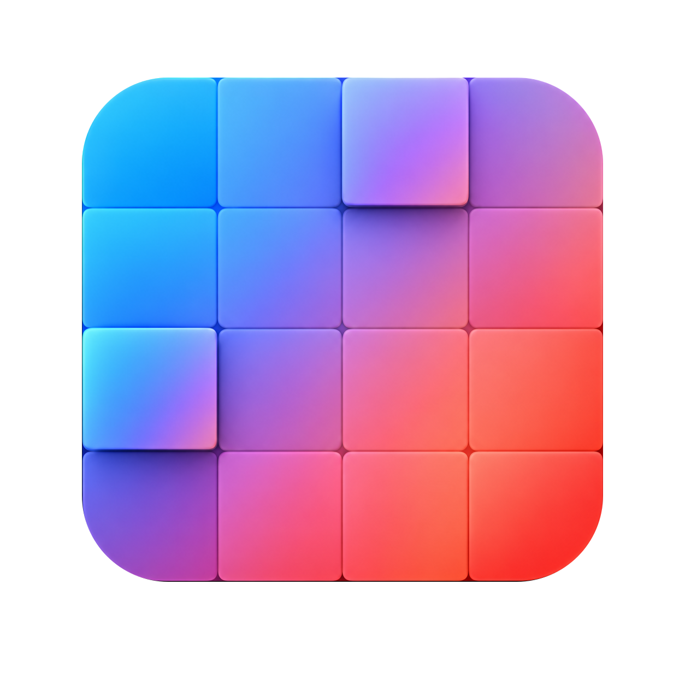
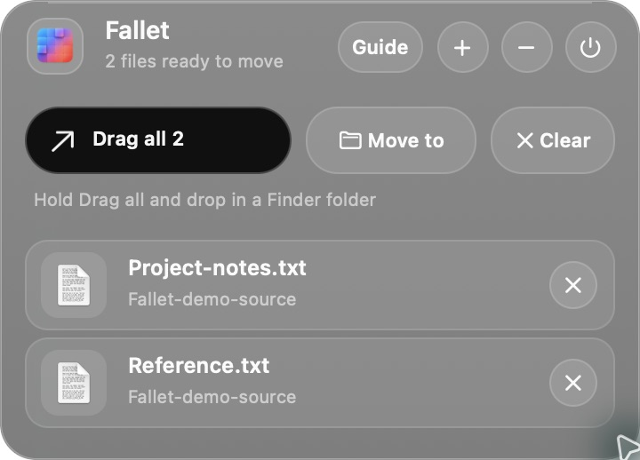
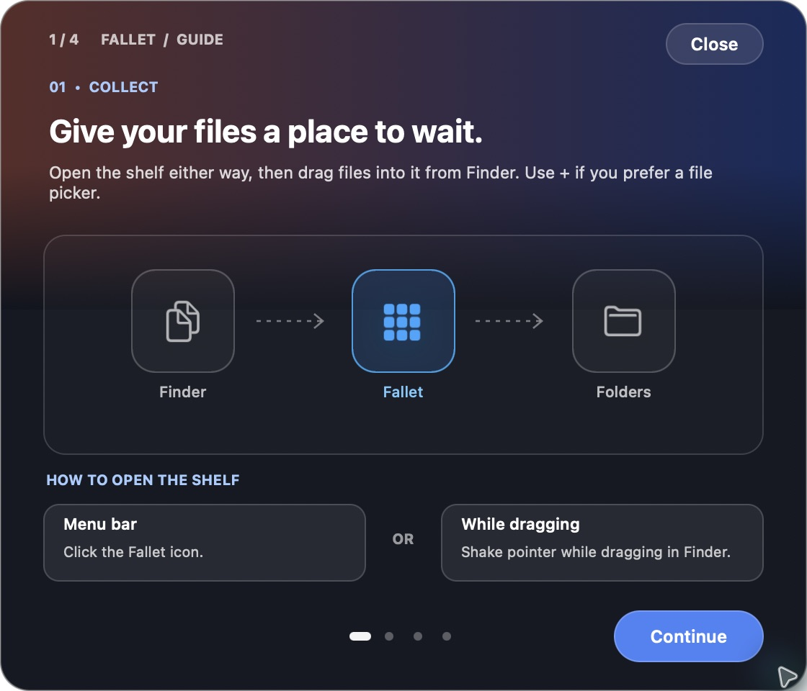
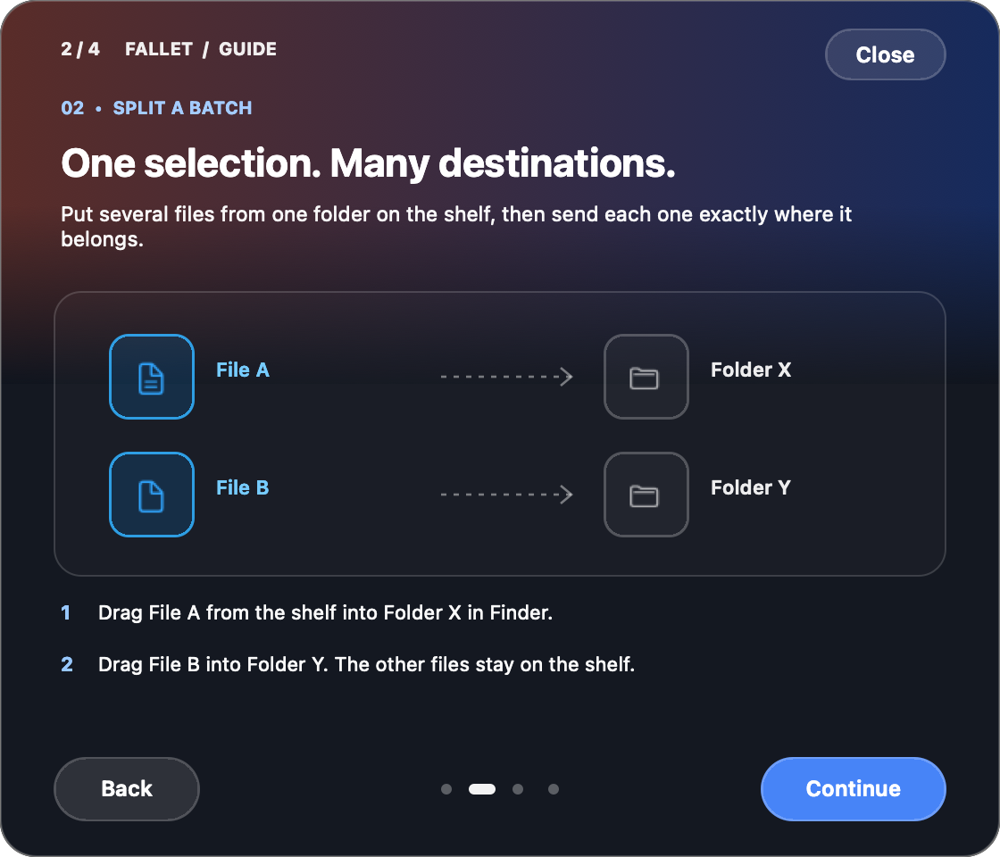
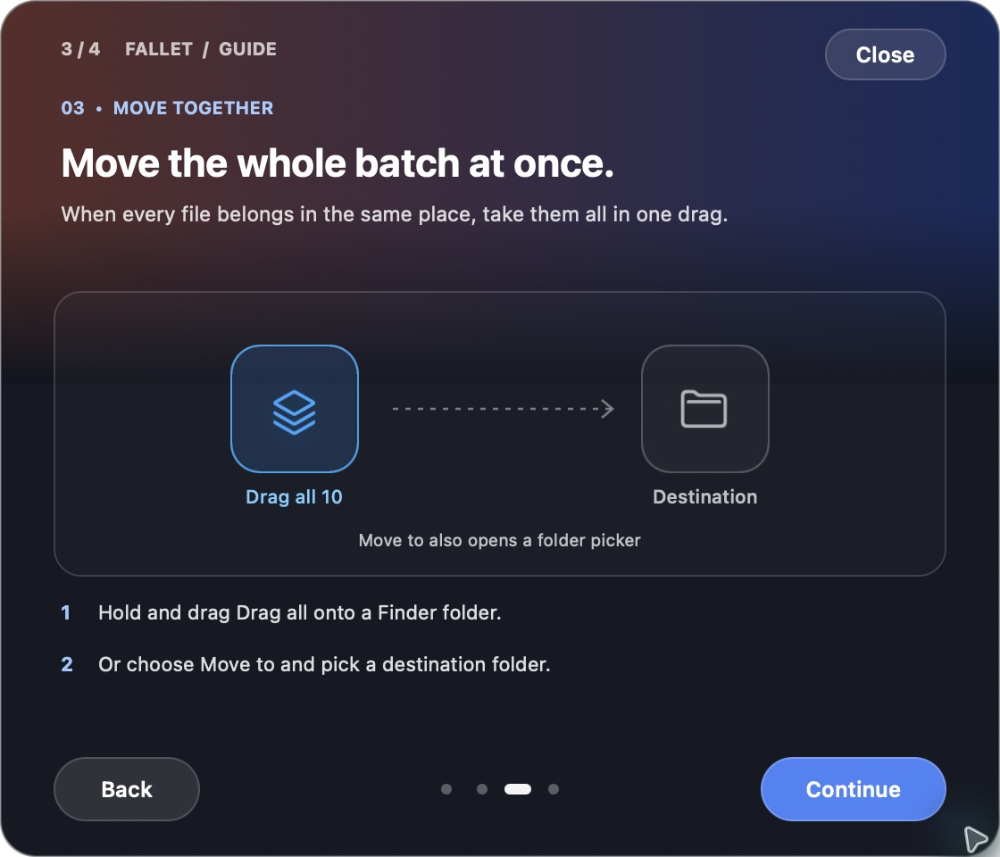
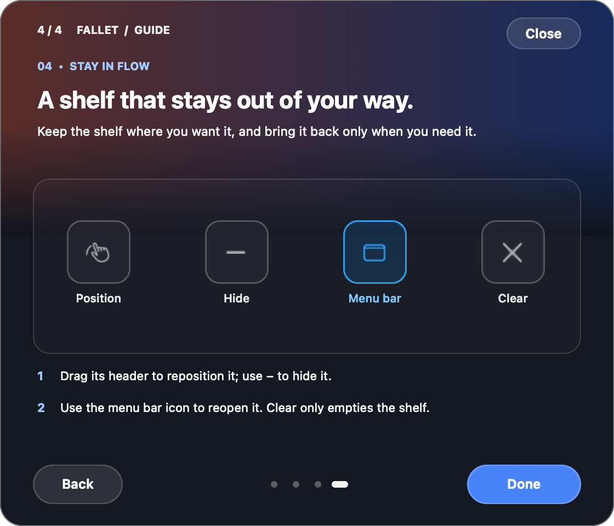

# Fallet



Fallet is a small macOS menu bar app for keeping files close while you move them around in Finder. Put several files on its floating shelf, then drag each file to a different destination or drag the whole batch to one folder.

## What it does

- Drag files or folders from Finder onto the shelf. The shelf holds references to their original locations; adding them does not copy or move them.
- Open the shelf from its menu bar icon, or shake the pointer while dragging files in Finder to bring it near the pointer.
- Drag an individual item from the shelf into a Finder folder. Use **Drag all** when everything belongs in the same folder.
- Use **Move to** to choose a destination folder, or **+** to add items with a file picker.
- Use **Clear** to empty the shelf without deleting the original files. The shelf hides when its last item is moved out.
- Open **Guide** in the shelf for a short walkthrough.

The shelf remembers its contents and window position between launches. It stores file paths in `~/Library/Application Support/Fallet/shelf.json` and imports existing entries from the former DropShelf build on first launch. Files stay at their original locations until you move them; Fallet does not upload them or use a network service.

## Download and install

When the first signed release is published, download the universal DMG from [GitHub Releases](https://github.com/Shinvitiya/Fallet/releases/latest). Open it, drag **Fallet.app** to **Applications**, eject the disk image, and launch Fallet from Applications. The same download supports Apple silicon and Intel Macs running macOS 13 or later.

The app appears in the menu bar when it starts. Use its icon to show or hide the shelf.

## Install with Homebrew

Homebrew can build Fallet from source on your own Mac without a Developer ID. This uses the project’s custom tap, rather than Homebrew’s official cask collection:

```sh
brew tap Shinvitiya/fallet https://github.com/Shinvitiya/Fallet.git
brew install Shinvitiya/fallet/fallet
fallet
```

The first install compiles the app and needs Xcode Command Line Tools (`xcode-select --install`). Homebrew keeps the app in its Cellar; the `fallet` command opens it. This route does not provide a downloadable DMG or put an app icon in Applications.

## Quick demo

This nine-second clip combines captures from a real two-file run: an empty shelf, two files ready to move, and both files in the Finder destination. Click the preview to watch the MP4.

<a href="docs/demo/fallet-demo.mp4"></a>

[Watch the demo video](docs/demo/fallet-demo.mp4)

## How to use Fallet

These are the four slides from the guide built into the app. Click a slide to see it at full size.

### 1. Collect files

<a href="docs/guide/01-collect.png"></a>

### 2. Split a batch between destinations

<a href="docs/guide/02-split-a-batch.png"></a>

### 3. Move the whole batch

<a href="docs/guide/03-move-together.png"></a>

### 4. Keep the shelf out of your way

<a href="docs/guide/04-stay-in-flow.png"></a>

## Build and run

Requirements: an Apple silicon or Intel Mac with macOS 13 or later, and Xcode Command Line Tools (`xcode-select --install`).

```sh
zsh build.sh
open dist/Fallet.app
```

`build.sh` compiles a universal Swift and AppKit app into `dist/Fallet.app` and signs it ad hoc for local development. Distributable DMGs are made by the separate [release process](RELEASING.md), which requires Developer ID signing and Apple notarization.

## How file moves work

Dropping an item from the shelf into Finder lets Finder perform the drag operation. Finder may copy instead of move depending on the destination and modifier keys. Fallet removes an item from the shelf when the drag reports a move or its original path no longer exists. The **Move to** button uses a native folder picker and moves every item currently on the shelf; if a destination name already exists, it adds a number to the incoming name.

## Contributing

See [CONTRIBUTING.md](CONTRIBUTING.md) for the project layout, test command, and contribution notes.

## License

Fallet is available under the [MIT License](LICENSE).
