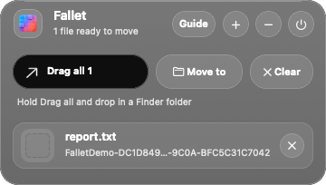
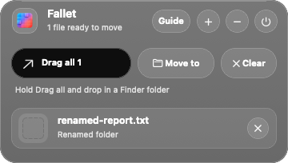
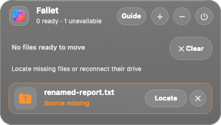
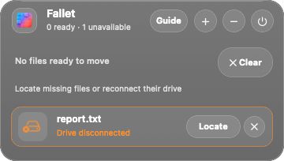
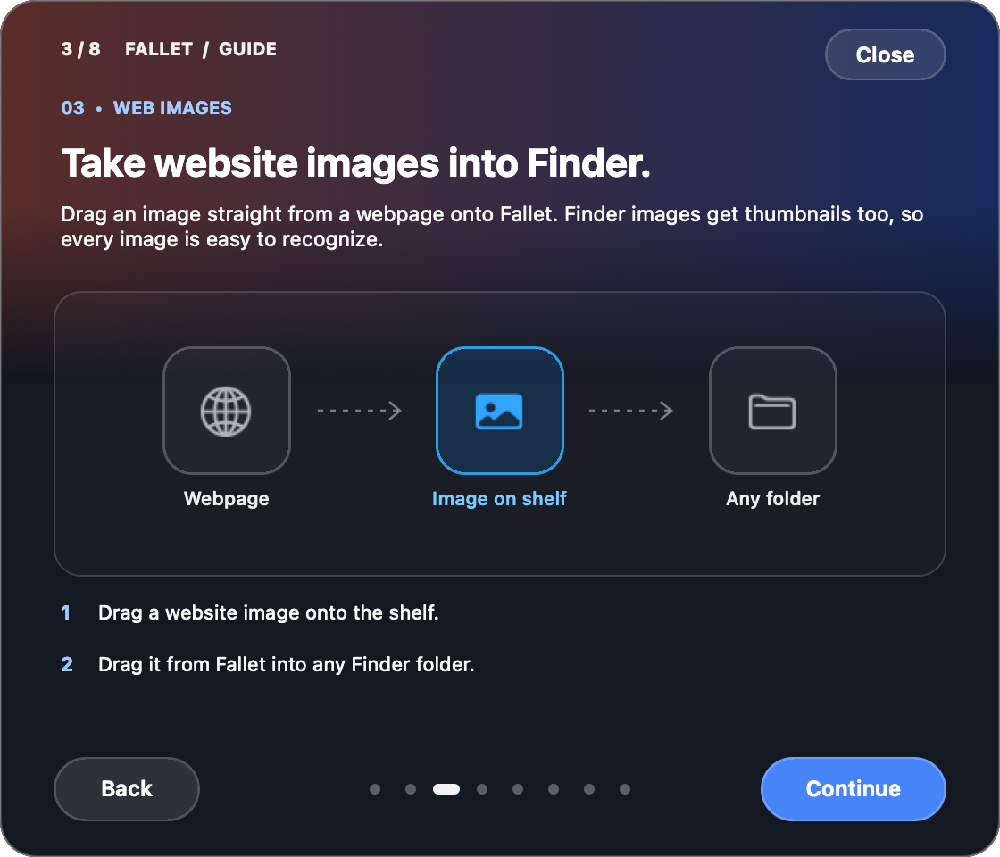
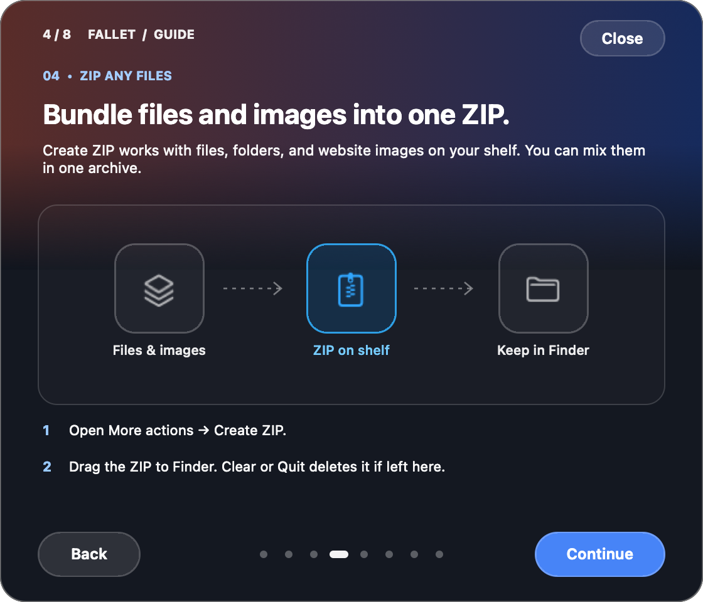
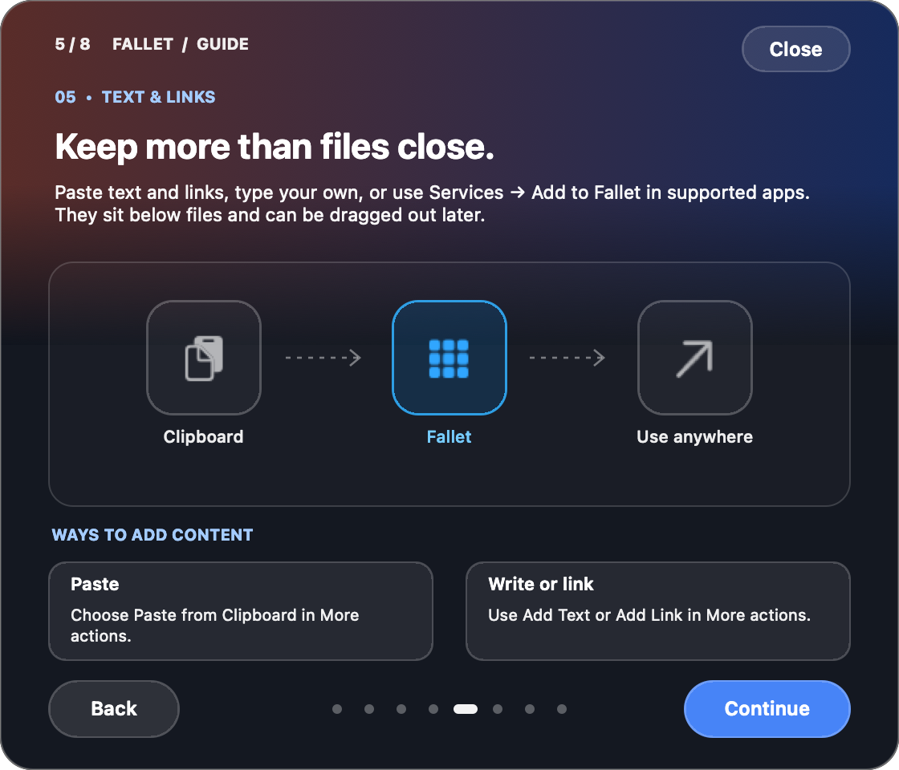
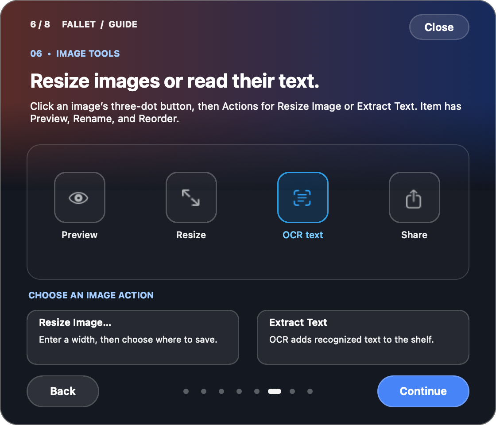
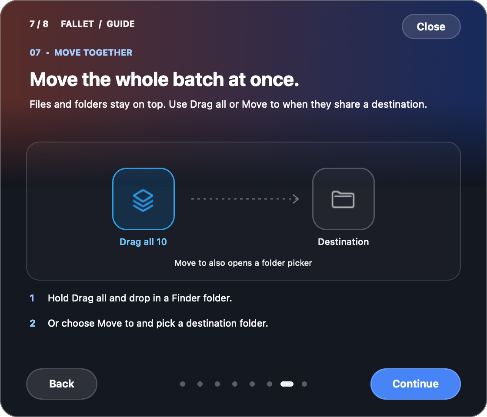
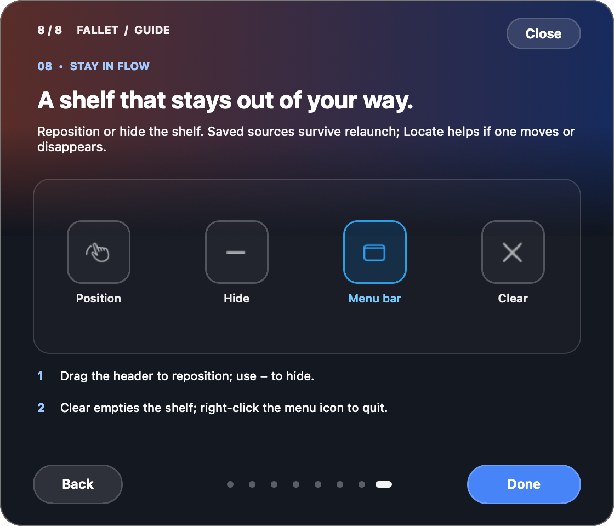

# Fallet


Fallet is a small macOS menu bar app for keeping files, images, links, and text close while you work. Put several files on its floating shelf, then drag each file to a different destination or drag the whole batch to one folder.

## What it does

- Drag files or folders from Finder onto the shelf. The shelf holds references to their original locations; adding them does not copy or move them. Images from Finder and websites show thumbnails. Drag website images into any Finder folder or bundle them into a ZIP with **Create ZIP**. Drop links and text on the shelf too.
- Open the shelf from its menu bar icon, press **Control–Option–Space**, or shake the pointer while dragging files in Finder to bring it near the pointer. You can also drop items onto its menu bar icon or the small target that appears below the notch while dragging on a MacBook with a notch.
- Drag an individual item from the shelf into a Finder folder. Use **Drag all** when everything belongs in the same folder.
- The shelf groups files and folders above text and links, even if you add the text first. Move Up and Move Down reorder within a group.
- Use **Move to** to choose a destination folder. Click the **⋮** button beside an item's thumbnail to preview, rename, reorder, or share it.
- Open **More actions** (the ellipsis in the header) for one list of ways to add files, clipboard contents, text, or links, share by AirDrop or another macOS service, and create a ZIP. The **⋮** button on an image row also offers Resize Image and Extract Text.
- Use **Clear** to empty the shelf without deleting original files; Fallet-generated images and temporary ZIPs are discarded. The shelf hides when its last item is moved out.
- Open **More actions → How to Use** for a short walkthrough. Right-click the menu bar icon for **Quit Fallet**.

In apps that offer macOS Services, select an item and choose **Services → Add to Fallet** to send it to the shelf. This is a Services command, not a Share extension. **Create ZIP** bundles any mix of shelf files, folders, and website images, then adds the archive to the shelf. Drag it to a Finder folder or use **Move to** to keep it. Fallet permanently deletes ZIPs still in its temporary folder when you remove them, clear the shelf, or quit the app. ZIPs moved out of that folder remain yours.

To resize an image or use OCR, click **⋮** beside its thumbnail and choose **Actions → Resize Image…** or **Extract Text**. Resize asks for a width and save location, then adds the resized PNG to the shelf. OCR reads text locally with Apple's Vision framework and adds it to the shelf as a text item.

The shelf remembers regular contents and window position between launches; temporary ZIPs are discarded on quit. It stores each source's last path and a macOS file bookmark in `~/Library/Application Support/Fallet/shelf.json`, and imports existing entries from the former DropShelf build on first launch. Files stay at their original locations until you move them; Fallet does not upload them or use a network service.

## Install with Homebrew

Install from the [dedicated Fallet tap](https://github.com/Shinvitiya/homebrew-fallet):

```sh
brew install Shinvitiya/fallet/fallet
fallet-app-link link
```

The second command creates a small, real `/Applications/Fallet.app` launcher and registers it with macOS. Open it from Finder, the macOS 26 **Apps** view (called **Launchpad** on older macOS), or run `fallet` in Terminal. It opens the current Homebrew app through the stable `opt/fallet` path, so upgrades do not leave an old copy behind. Fallet then appears in the menu bar; left-click to show or hide the shelf and right-click for Quit. The setup command removes only Fallet's older managed entry from `~/Applications` after installing the new launcher. It preserves an unrelated `/Applications/Fallet.app` and reports the conflict. If your account cannot write to `/Applications`, use `fallet-app-link link --user` to install in `~/Applications` instead. App indexing may take a moment; run `fallet-app-link link` again to refresh registration if needed.

The first install builds from source on your Mac, so you need Xcode Command Line Tools (`xcode-select --install`). The formula supports Apple silicon and Intel Macs on macOS 13 or later and keeps its launcher in Homebrew’s `bin` directory. The fully qualified install command automatically taps and trusts only this formula under [Homebrew’s third-party tap rules](https://docs.brew.sh/Tap-Trust).

To update an installed copy, quit Fallet and run `brew upgrade fallet`, then launch it from Apps, Finder, or with `fallet`. The Applications launcher opens the new Homebrew version automatically. Fallet checks GitHub's latest stable release and the dedicated tap formula in the background at launch and about once a day. If a newer release is present in the tap, a small **New v…** badge appears beside its name. Homebrew installs offer a button to copy `brew upgrade fallet`; source-built copies show the release page instead. A failed network or tap check retries later, without delaying startup. Fallet never downloads or installs updates itself.

To uninstall Fallet completely, run:

```sh
fallet-uninstall
```

This quits Fallet, removes its managed launchers from both Applications folders, uninstalls the Homebrew formula, deletes Fallet's saved shelf, generated images, caches, and preferences, and cleans its Homebrew download cache and tap. **Files you added from Finder remain at their source locations; files you already dragged out of the shelf remain at their destinations.** Website images and other generated files still inside Fallet's support folder are deleted. The command preserves unrelated apps. If you want to keep your shelf data for a later reinstall, run `fallet-app-link unlink` followed by `brew uninstall fallet` instead. `fallet-app-link status` checks the launcher in `/Applications` (`--user` checks `~/Applications`).

Older installations made with `brew tap Shinvitiya/fallet https://github.com/Shinvitiya/Fallet.git` can keep using `brew upgrade fallet`: the release workflow updates that original formula as well. To switch the existing tap to the dedicated repository without uninstalling Fallet, run `brew tap --custom-remote Shinvitiya/fallet https://github.com/Shinvitiya/homebrew-fallet.git`, then `brew update`. Shelf data stays in `~/Library/Application Support/Fallet/`.

Homebrew keeps the source-built app in its Cellar, and the `/Applications` launcher opens that copy. If you previously launched a separate Fallet build, quit that copy before using the Homebrew version so only one instance runs. No Apple Developer ID or notarization is required for the local source build, and there is no public ad-hoc signed DMG. Depending on your Mac’s security settings, macOS may still ask you to approve a locally built app; Fallet does not ask you to disable Gatekeeper globally. See [RELEASING.md](RELEASING.md) for how releases become available.

## Quick demo

This nine-second clip combines captures from a real two-file run: an empty shelf, two files ready to move, and both files in the Finder destination. Click the preview to watch the MP4.

<a href="docs/demo/fallet-demo.mp4"></a>

[Watch the demo video](docs/demo/fallet-demo.mp4)

## If a saved file moves or disappears

Fallet uses the bookmark to find a file renamed or moved in Finder while the app is closed. If the file was deleted or cannot be found, its entry stays on the shelf with a **Source missing** label and a **Locate** button. A source on a disconnected external drive is labelled **Drive disconnected**; reconnect the drive and Fallet checks again, or use **Locate** if the drive remounts elsewhere. **Drag all** and **Move to** use only files that are currently available.

These captures show an isolated persistence test: a saved file, the same file after a Finder rename and move while Fallet was closed, a deleted source, and a disconnected drive.

| Saved source | Renamed and moved while closed |
| --- | --- |
|  |  |

| Deleted source | Disconnected drive |
| --- | --- |
|  |  |

Entries saved by older versions had paths only. Fallet adds bookmarks for those still accessible; an entry already removed by an older launch cannot be restored automatically.

## How to use Fallet

These are all eight slides from the guide built into the app. Click a slide to see it at full size.

### 1. Collect files

<a href="docs/guide/01-collect.png"></a>

### 2. Split a batch between destinations

<a href="docs/guide/02-split-a-batch.png"></a>

### 3. Take website images into Finder

<a href="docs/guide/03-web-images.png"></a>

### 4. Bundle files, folders, and images into a ZIP

<a href="docs/guide/04-zip-images.png"></a>

### 5. Keep text and links close

<a href="docs/guide/05-text-links.png"></a>

### 6. Resize an image or extract text

<a href="docs/guide/06-item-tools.png"></a>

### 7. Move the whole batch

<a href="docs/guide/07-move-together.png"></a>

### 8. Keep the shelf out of your way

<a href="docs/guide/08-stay-in-flow.png"></a>

## Build and run

Requirements: an Apple silicon or Intel Mac with macOS 13 or later, and Xcode Command Line Tools (`xcode-select --install`).

```sh
zsh build.sh
open dist/Fallet.app
```

`build.sh` compiles a universal Swift and AppKit app into `dist/Fallet.app` and signs it ad hoc for local development. The free Homebrew release builds on each user's Mac. An optional distributable DMG requires Developer ID signing and Apple notarization, which this project does not currently have.

## How file moves work

Dropping an item from the shelf into Finder lets Finder perform the drag operation. Finder may copy instead of move depending on the destination and modifier keys. Fallet removes an item from the shelf when the drag reports a move or the source disappears from an available volume during the drag. The **Move to** button uses a native folder picker and moves every available item currently on the shelf; if a destination name already exists, it adds a number to the incoming name.

## Contributing

See [CONTRIBUTING.md](CONTRIBUTING.md) for the project layout, test command, and contribution notes.

## License

Fallet is available under the [MIT License](LICENSE).
